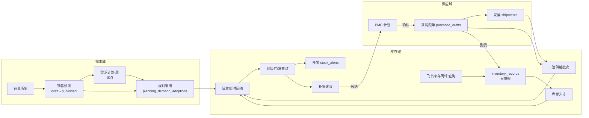
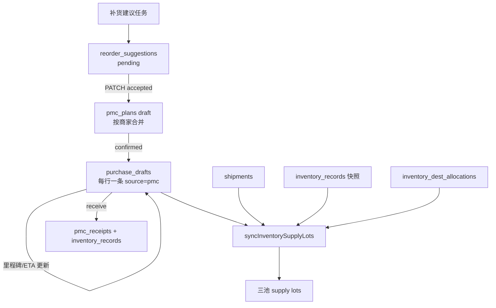

# 需求 · 供应 · 库存 业务与系统逻辑说明

> 版本：2026-09-29 ｜ 依据：当前工作区代码（`packages/db/src/schema`、`apps/web/server`、`apps/web/src`）与 `docs/prd`、`docs/superpowers/specs`。  
> SKU 库存规划页每个可见字段的取值与算法见 **§3.8**。
> 所有 HTTP 接口挂载在 `/api` 前缀下（`apps/web/server/index.ts`）。文中路径均相对于仓库根目录。

---

## 0. 总览

### 0.1 业务闭环

跨境长交期（30–90 天）场景下，系统串起「销量事实 → 销售预测 / 需求计划 → 库存头寸与日时间轴 → 补货建议 → PMC 计划 → 采购跟单 → 发运 → 三池供给批次 → 到仓入库」的计划闭环。



### 0.2 双引擎划分

| 引擎 | 职责 | 明确不做 |
|------|------|----------|
| 库存规划 | 该不该补、补多少、何时下单、断货/积压判断 | 工厂 MES、正式财务 PO |
| 供应商 PMC | 计划下发、跟单状态、ETA/里程碑、到货回写 | 船司轨迹 API（发运为台账）；FOB 结算为独立模块 |

来源：`docs/superpowers/specs/2026-07-29-inventory-planning-pmc-evolution-design.md`、`docs/prd/mvp-business-loop.md`。

### 0.3 关键常量速查

| 常量 | 值 | 文件 |
|------|----|------|
| 预测地平线 `FORECAST_HORIZON_MONTHS` | 6 个自然月 | `apps/web/server/lib/forecast-limits.ts` |
| 需求计划地平线 `DEMAND_PLAN_HORIZON_WEEKS` | 26 个 ISO 周 | `apps/web/server/lib/planning-calendar.ts` |
| 默认生产提前期 `DEFAULT_PRODUCTION_LEAD_DAYS` | 50 天 | `apps/web/server/lib/replenishment-coverage.ts` |
| 默认安全库存天数 `DEFAULT_SAFETY_STOCK_DAYS` | 14 天 | 同上 |
| 默认超储阈值 `DEFAULT_OVERSTOCK_THRESHOLD_DAYS` | 180 天 | 同上 |
| 单次补货覆盖上限 `SINGLE_REPLENISHMENT_COVER_DAYS` | 30 天 | `apps/web/server/lib/inventory-timeline.ts` |
| 默认入仓缓冲 | 7 天 | 同上 / `warehouses.inbound_buffer_days` |
| 需求反推封顶 `UNCONSTRAIN_CAP_RATIO` | 1.5 | `apps/web/server/lib/forecast-demand-unconstrain.ts` |
| 有货覆盖率门槛 `MIN_AVAILABILITY_COVERAGE` | 0.3 | `apps/web/server/lib/inventory-health-service.ts` |
| 销售占比偏差告警 `SHARE_MISMATCH_DELTA` | 0.05 | `apps/web/server/lib/inventory-share-allocation.ts` |
| Horizon 预警日 | 7 / 15 / 30 天 | `apps/web/server/lib/inventory-horizon-alerts.ts` |

### 0.4 逻辑仓

| 仓码 | 含义 | 来源 |
|------|------|------|
| `IN-PRODUCTION` | 在产池（出货前本地批次） | `apps/web/server/lib/inventory-constants.ts` |
| `OVERSEAS` | 未定目的仓的海外/在途网络合计，**不是物理仓** | 同上 |
| `ALL` | 需求计划/安全库存的网络级仓码 | `demand-plan-config.ts`、`safety_stock_config` |

---

## 1. 需求域

### 1.1 范围

| 子模块 | 职责 | 主要代码/表 |
|--------|------|-------------|
| 销量历史 | 日/月销量入库、平台归一、月聚合 | `sales_history*`、`sales-history-import.ts` |
| 销售分析 | 多维立方快照（看板用，非计划主数据） | `sales_analytics_cube_snapshots`、`sales-analytics-cube.ts` |
| 销售预测 | 基线生成、ABCD / AllCat V4.1 分层、版本评审发布、准确率 | `sales_forecast_*` |
| 需求计划（试点） | 周粒度需求、发布/采用，与预测 Champion 对照 | `demand_plan_*`、`planning_demand_adoptions` |
| 有效日需求 | 用有货日还原真实需求水平 | `effective-daily-demand.ts`、`forecast-demand-unconstrain.ts` |
| SKU 生命周期 | 由销量推断生命周期标签 | `skus.lifecycle`、`sku-lifecycle.ts` |

> 说明：`layered-forecast`（分层预测）的 schema、路由、页面在当前工作区已被删除（未提交），本文不作为现行功能描述。现行“分层”体现在 ABCD Profile Class 和 AllCat V4.1 的 T1–T99 分层。

### 1.2 核心数据表

**SKU（需求相关字段，`packages/db/src/schema/inventory.ts` → `skus`）**：`project_group`（需求计划范围）、`lifecycle`、`commercial_status_*`、`force_forecast`（绕过准入强制进预测）、`encoding_meta`（含周转快照仓份额）。

| 表 | 唯一约束 | 关键字段 |
|----|----------|----------|
| `sales_history` | `(sku_id, sale_date, channel, station)` | `qty_sold`、`warehouse_code`、`import_batch_id` |
| `sales_history_monthly` | `(sku_id, channel, sale_year, month)` | `qty_sold`、品类快照 |
| `sales_forecast_versions` | `version_no` | `status`、`start_month`、`published_at` |
| `sales_forecast_monthly` | 含 `version_id` | `forecast_daily_avg`、`baseline`、`manual`、`platform`、`forecast_profile_class`、`profile_segment`、`horizon_factors`、`forecast_model` |
| `sales_forecast_review_items` | `(version, sku, station, platform, issue_type)` | `severity`、`status` |
| `forecast_accuracy_monthly` | 含 `version_id` | `bias_rate`、`mape` |
| `sales_forecast_seasonality` | — | 按品类/项目组的季节因子 |
| `forecast_promo_calendar` / `forecast_exogenous_flags` | — | 大促与外生事件剔除 |
| `sales_platforms` / aliases | — | 渠道归一（`sales-platform.ts`） |
| `demand_plan_versions` | — | `status`、`start_week`、`horizon_weeks`、`project_group`、`warehouse_code`（常为 `ALL`） |
| `demand_plan_weekly` | `(version, sku, warehouse, ISO 周)` | `system_daily`、`manual_daily` |
| `demand_plan_monthly` | 同上（`YYYY-MM`） | 现主路径以周为主 |
| `planning_demand_adoptions` | `(project_group, warehouse_code)` | `source` = `forecast` / `demand_plan`，绑定采用版本 |
| `demand_plan_pilot_snapshots` | — | 试点对照快照 |

### 1.3 端到端流程

| 步骤 | 输入 | 规则 | 输出 |
|------|------|------|------|
| ① 销量导入 | 每日宽表 CSV，`POST /import/sales`（`import.ts` + `sales-xiaoshou.ts`）；飞书长表每天 05:00 拉取 | 平台归一、station 分桶；新行插入，同一 SKU + 日期 + 渠道 + 站点覆盖销量；导入后刷新 SKU 生命周期并异步重建销售分析立方 | `sales_history` |
| ② 清洗与聚合 | 日表 | 日表默认保留 365 天（`sales-history-config.ts`）；训练用月序列剔除缺货/大促（`forecast-monthly-clean.ts`） | 月度干净序列 |
| ③ 分层 | 近 12 个月销量 | ABCD：连续性/CV 阈值（`forecast-profile-config.ts`）；默认算法模式 `allcat_v41`（`forecast-algo-mode.ts`）→ T1–T99 | `forecast_profile_class`、`profile_segment` |
| ④ 基线预测 | 日/月销量、季节因子、准入 | 异步任务 `forecast_baseline`（`forecast-baseline-task.ts`）；monthly_abcd 模式下用 T1/T2/T3 核 | 草稿版本的 `sales_forecast_monthly` |
| ⑤ 评审与协同 | 规则 + 回测 | 生成评审项，批量接受/忽略；发布前 `validateForecastRows` | 评审项 `reviewed` / `ignored` |
| ⑥ 发布 | draft 版本 | 仅 draft 可发布（`forecast-version.ts`）；可多个 published 并存，消费侧按 SKU 取最新 `published_at`（`forecast-published-resolve.ts`） | Champion 预测 |
| ⑦ 需求计划生成 | 近 90 天销量 + 库存快照 + 已发布预测 | 26 周；`system = U × share × clip(月预测 / championRef, 0.5, 2.0)`（`demand-plan-reconstruct.ts`） | draft + 周行 |
| ⑧ 发布/采用 | draft | → `pilot_published`，同项目组同仓旧版本归档；可选写入 adoption | 采用关系 |
| ⑨ 规划解析 | adoption + 试点开关 | `loadPlanningDemandForSkuWarehouse` → `resolvePlanningDemandFromInputs`；有效值 = `manual ?? system` | 需求 Map 供库存域 |
| ⑩ 需求门禁 | WMAPE、反推封顶 | `planning-demand-gate.ts`：触发封顶或 WMAPE 不达标 → 需人工确认，不进自动队列。WMAPE 取 SKU 最近已结算月，同站点×平台只取最新计算的一版，按实际日均加权（`computeRecentSkuWmape`）；封顶判定为试点需求计划 `reconstructed_shape` 且还原日均 > 日均 × (1.5 − 0.01)（`isDemandReconstructCapHit`）；补货任务与 SKU 规划页同源 | 标志位 |

**冻结期**：需求计划编辑时，前 `ceil(leadDays / 30)` 个月不可修改（`demand-plan-freeze.ts`）。

**试点开关**（`demand-plan-config.ts`）：`DEMAND_PLAN_PILOT_ENABLED`、`DEMAND_PLAN_PILOT_PROJECT_GROUPS`、`DEMAND_PLAN_PILOT_WAREHOUSES`（空 = 组内全仓）。

### 1.4 关键算法与参数

| 主题 | 规则 | 来源 |
|------|------|------|
| 预测准入 | 近期有销即可进入；近期销量 ≥5 为 core，≥1 为 mid，否则 tail；`force_forecast` 可绕过 | `forecast-eligibility.ts` |
| 销量生命周期 | 上架 <90 天→new；有销日占比 <0.1→intermittent；30/90 天比 >1.3→growth、<0.7→decline；连续零销 ≥7 天→疑似缺货 | `forecast-baseline.ts` |
| ABCD 阈值 | continuityMinA 0.75、cvMaxA 1.0、continuityMinB 0.75、cvMaxC 1.5 等（可被 `forecast-calibration.json` 覆盖） | `forecast-profile-config.ts` |
| 算法模式 | `legacy` / `monthly_abcd` / `allcat_v41`（默认，环境变量 `FORECAST_ALGO_MODE`） | `forecast-algo-mode.ts` |
| V4.1 分层示例 | A 类 + AMAZON：近 6 月日均 ≥20、6 月全活跃、CV ≤0.65 → T1 | `forecast-allcat-v41.ts` |
| T1 偏差预算 | 地平线 k≤0：12%；k≤2：15%；其余 18% | `forecast-t1-anchor.ts` |
| 地平线分段 | k≤2 precision；k≤5 flex；其余 strategic | `forecast-horizon-band.ts` |
| 需求反推 | 封顶 1.5 倍；最短连续段 7 天；有效比例 0.3 | `forecast-demand-unconstrain.ts` |
| 有效日需求 | 默认 90 天窗口；有库存快照时只统计 `qty_available > 0` 的日子 | `effective-daily-demand.ts` |

### 1.5 状态机

| 对象 | 状态 |
|------|------|
| 销售预测版本 | `draft` → `published` → `archived`；draft 可删除 |
| 评审项 | `pending` / `reviewed` / `ignored` |
| 季节重建源批次 | `uploaded` / `parsed` / `generated` / `failed` |
| 需求计划版本 | `draft` → `pilot_published` → `archived` |
| 规划采用来源 | `forecast` / `demand_plan` |

### 1.6 主要 API

| Method | Path | 用途 |
|--------|------|------|
| GET | `/sales/history`、`/sales/history/monthly` | 日/月销量 |
| GET/POST | `/import/sales` | 销量导入预览/执行 |
| POST | `/sales-forecasts/generate-baseline` | 异步基线生成（轮询 `/generate-baseline/tasks/:taskRunId`） |
| GET/PUT | `/sales-forecasts`、`/sales-forecasts/:id` | 列表 / 人工改数 |
| GET | `/sales-forecasts/horizon`、`/horizon/export` | 地平线视图 |
| GET/PATCH | `/sales-forecasts/review-items*` | 评审队列 |
| GET/POST | `/sales-forecast-versions*` | 版本 CRUD、校验、发布、归档 |
| GET/POST | `/sales-forecasts/accuracy*` | 准确率与回测 |
| POST | `/sales-forecasts/dify/single` | Dify 单 SKU 辅助预测 |
| POST | `/sales-forecasts/monthly-sales/aggregate` | 日→月重聚合 |
| GET/POST | `/demand-plans`、`/demand-plans/generate` | 需求计划列表 / 生成草稿 |
| GET | `/demand-plans/:id`、`/:id/sku-detail` | 详情 / SKU 抽屉 |
| POST | `/demand-plans/:id/publish`、`/adopt`、`/archive` | 发布、采用、归档 |
| PATCH | `/demand-plans/:id/weeks/:weekId`、`/months/:monthId` | 修改周/月需求 |
| POST | `/demand-plans/adopt-forecast` | 切回预测作为需求源 |
| GET/POST | `/sales-analytics/status`、`/cube`、`/rebuild` | 销售分析立方 |

### 1.7 页面

| 菜单 | 路由 | 页面 |
|------|------|------|
| 销售分析看板 | `/data/sales-analytics` | `SalesAnalyticsPage.tsx` |
| 销量历史 | `/data/sales` | `SalesHistoryPage.tsx` |
| 销售预测 | `/data/forecast`、`/data/forecast/:versionId` | `SalesForecastListPage.tsx`、`SalesForecastVersionDetailPage.tsx` |
| 需求计划-周 | `/data/demand-plan`、`/data/demand-plan/:id` | `DemandPlanPilotPage.tsx`、`DemandPlanDetailPage.tsx` |

---

## 2. 供应域

### 2.1 范围

在不接正式 ERP 采购单、船司 API、供应商门户的前提下，跑通「补货建议 → PMC 计划 → 采购跟单 → 发运里程碑 → 三池供给批次 → 到仓入库」，并支持出货前不定目的仓的 `OVERSEAS` 未分配供应池确认落仓。

飞书镜像列表 `bulk_stock_request`（大件备货申请）与 `purchase_follow_up`（采购跟单）是**在途/在产供给的唯一单据来源**（三池同步 `syncInventorySupplyLots`）。`bulk_stock_request.目的仓` 经 `需求单号` 关联到跟单行；无目的仓时批次留在 `OVERSEAS`。系统内历史 `purchase_drafts` / `shipments` 不再参与批次构建。

### 2.2 核心数据表

| 表 | 唯一约束 | 关键字段 / 说明 |
|----|----------|-----------------|
| `reorder_suggestions` | — | `sku_id`、`warehouse_code`、`suggested_qty`、`suggested_date`、`health_status`、`coverage_days`、`total_lead_days`、`latest_order_days`、`metrics`、`status`、`plan_id`、`superseded_at` |
| `pmc_plans` | `plan_no` | `merchant_code`、`plan_date`、`delivery_date`、`status`、`target_warehouse_code`（可空） |
| `pmc_plan_items` | FK `plan_id` 级联 | `planned_qty`、`completed_qty`、`warehouse_code`（行级目的仓） |
| `material_requirements` | — | `sufficient/shortage/ordered`；**已建表但服务端未使用** |
| `purchase_drafts` | `draft_no` | `source` = `reorder/pmc/manual`、`source_ref_id`、`plan_item_id`、`status`、`expected_date`、`eta_available`（同步 `confirmed_delivery_date`）、生产/物流里程碑日期、`received_qty` |
| `purchase_follow_up_reminders` | `(draft_id, milestone)` | T-30 / T-14 / T-7 提醒 |
| `shipments` | `shipment_no` | 可选 `draft_id`、`plan_item_id`；`destination_warehouse_code`；`status`（varchar）；`eta_available` |
| `shipment_milestones` | `(shipment_id, milestone)` | 计划/实际日期 |
| `inventory_supply_lots` | `(source, source_id, pool, warehouse_code)` | `pool`、`available_at`、`source`、`status`、`production_status`、`date_unknown`、`eta_estimated` |
| `inventory_dest_allocations` | `(source, source_id, pool, warehouse_code)` | 未定仓批次的确认落仓结果 |
| `lead_time_profiles` | — | 分段天数：生产/国内/订舱/海运/清关/入仓；可选 `merchant_code`、`destination_warehouse_code`、`transport_mode`、`is_default` |
| `warehouses` | `code` | `shipping_lead_days`、`inbound_buffer_days`（默认 7）、`region_group`、`allow_cross_fulfill` |
| `pmc_receipts` | `idempotency_key` | 到货记录，关联 `inventory_record_id` |
| `procurement_list_meta` / `procurement_list_rows` | `list_type` | 飞书采购列表镜像，`row_data` JSON |

MOQ 与交期来源：`spus.moq`、`skus.moq`、`skus.lead_time_days`、`merchants.production_lead_days`（默认 50）、`sku_suppliers(sku_id, merchant_id)` 的 `lead_time_days` / `moq`。

### 2.3 端到端流程



**① 补货建议**（`apps/web/server/tasks/replenishmentForecast.ts`）

- 先执行一次三池同步（失败只告警不中断）。
- 对活跃 SKU × 活跃仓，按与总览同源的库存口径计算健康度（`computeSkuWarehouseHealth`），跑时间轴。
- MOQ：`resolveEffectiveMoq(sku.moq, spu.moq)`，SKU 优先。
- 补货灯过滤 `shouldReplenishByLight`：黄灯仅在同 SPU 存在红灯必补 SKU 时才补（`replenish-light.ts`）。
- US 仓网单仓低于 ROP 但仓网总量足够时可延后（`shouldDeferReplenishment`，`warehouse-domain.ts`）。
- 写入前把该 SKU 旧的 pending 建议标记 `superseded_at`；新建议 `status = pending`。
- 若新 PO 已来不及覆盖缺货（`uncoverable_by_new_po`），`metrics` 中附只读动作建议：互调 / 快船 / 接受断货（`planning-late-po-actions.ts`），不自动执行。
- 可选 Dify 润色建议理由。

**② 建议 → PMC**（`PATCH /reorder/suggestions/:id`，`pmc-plan.ts`）

- 按商家查找或新建 draft 计划；同 SKU 行数量累加；`delivery_date` 取建议日期。
- 建议置 `accepted`、写 `plan_id`，同时关闭该 SKU+仓的相关预警。

**③ PMC 确认 → 采购跟单**（`PATCH /pmc/plans/:id/status`）

- `draft → confirmed` 时，每个计划行生成一条 `purchase_drafts`（`source = pmc`、初始 `draft`、`expected_date = plan.delivery_date`），并排程 T-30/T-14/T-7 跟单提醒。
- 手工 `POST /purchase-drafts` 返回 403：跟单只能由计划确认生成；列表接口也只返回 `source = pmc` 的记录。

**④ 跟单里程碑与 ETA**（`PATCH /purchase-drafts/:id`）

- 状态迁移由 `purchase-draft-lifecycle.ts` 校验。
- `buildEtaPatch` 同步写 `eta_available` 与 `confirmed_delivery_date`，并可反推 `shipReadyAt = eta − 剩余物流天数`（`purchase-draft-eta.ts`）。
- 首次 `confirmed` 写 `supplier_confirmed_at`；若无 ETA，用 `expected_date` 填充。

**⑤ 发运**（`shipments.ts`）

- 创建时必须指定目的仓；里程碑依次为 `booked → loaded → departed → arrived_port → customs → received_wh → available`。
- 延误：单里程碑 `delay = max(0, (实际或今天) − 计划)`；发运级取各里程碑最大值与 ETA 延误的最大值（`shipment-delay.ts`）。
- 无目的仓的发运**不进入**供给批次。

**⑥ 三池同步** `syncInventorySupplyLots`（`inventory-supply-lot-sync.ts`）

1. 读取各物理仓最新 `inventory_records`（`source = import`，排除 `IN-PRODUCTION` 与 `pmc_receipt` / 手工行），以及在产仓最新 `qty_in_production`（同样仅 `import`）。
2. 读取飞书镜像 `procurement_list_rows`：`purchase_follow_up` 提供在途/在产单据（数量、状态、确认交期/交货日期/预计货好时间）；`bulk_stock_request` 经 `需求单号` 提供 `目的仓`。
3. 从 `skus.encoding_meta` 取销售占比、在途分桶、最早在途/PO 上架时间。
4. 纯函数 `buildLotsFromInputs` 构建批次（`shipments` 入参恒为空；不再读 `purchase_drafts`）。
5. 取消旧的非 manual open 批次，按唯一键 upsert 新批次。

跟单状态 → 池映射（`inventory-supply-lots.ts`）：

| 跟单状态 | 池 | 无行级仓时的仓码 |
|----------|----|------------------|
| draft / confirmed / exception / in_production / ready_to_ship | `local` | `IN-PRODUCTION` |
| in_transit / partial_received | `in_transit` | `OVERSEAS` |

快照侧：`OVERSEAS` 可售按销售占比拆到物理仓（`pool = overseas`）；海外在途扣掉已有单据量后的残差按在途分桶拆分；在产残差（快照 − 跟单 local 量）落 `IN-PRODUCTION`，`available_at` 取周转快照中的“采购单最早上架时间”。

**⑦ 到货入库**

- 两个入口：`POST /purchase-drafts/:id/receive`（内部委托）和 `POST /pmc/plans/:id/items/:itemId/receive`（`pmc-receipt.ts`）。
- 计划须为 `confirmed` 或 `in_progress`；目的仓按「请求 → 计划行 → 计划头」取值，必填。
- 写 `inventory_records`（`source = pmc_receipt`）和 `pmc_receipts`（幂等键），累加 `completed_qty`；首次收货计划变 `in_progress`，全行完成变 `completed`；跟单累加 `received_qty`，变 `partial_received` / `received`。幂等键由调用方提供；命中重复键时直接返回原收货记录，跟单不再累加。

**⑧ 未分配供应池**（`inventory-dest-allocation*.ts`）

- 判定：`status = open` 且 `warehouse_code = OVERSEAS`。
- 目的仓只来自迅捷经飞书同步的数据（周转快照物理仓列、大件备货「目的仓」）；**本系统不再确认落仓**，三池同步也不套用 `inventory_dest_allocations`。
- 有销售占比时，规划/有效供给可按占比做**只读参考拆分**；无占比时生成 `unallocated_warehouse` 数据问题工单。

### 2.4 关键规则与公式

**交期解析**（`lead-time-resolver.ts`）——在同目的仓、`is_default = true` 的 profile 中按优先级选取：

1. 商家 + 运输方式
2. 商家 + 运输方式为空
3. 商家为空 + 运输方式
4. 两者均为空的默认行

命中时 `totalLeadDays = 生产 + 国内 + 订舱 + 海运 + 清关 + 入仓`。未命中时回退：

| 段 | 回退顺序 |
|----|----------|
| 生产 | 商家 `production_lead_days` → 默认供应商 `lead_time_days` → SKU `lead_time_days` → 50 |
| 海运 | 仓 `shipping_lead_days` → 内置默认（US-WEST 45；US-EAST/SOUTH/SOUTHEAST 60；UK 75；DE 80）→ 60 |
| 入仓 | 仓 `inbound_buffer_days` → 7 |

出货前批次只计生产段（`resolvePreShipmentLeadTimeForSku`）；三池同步时 open 跟单的剩余物流天数取 0。

**本地批次可售日**：`available_at = shipReadyAt + 剩余物流天数`，回退链为 shipReadyAt → 计划完工日 → `eta_available`。

**批次能否进时间轴** `isLotEligibleForTimeline`：没有 `available_at` 不进；`local` 池仍在产/待质检，或 `shipReadyAt` 晚于今天，也不进。

### 2.5 状态机

| 对象 | 状态 / 迁移 |
|------|-------------|
| 补货建议 | `pending` → `accepted` / `ignored` |
| PMC 计划 | `draft` → `confirmed` / `cancelled`；`confirmed` → `in_progress` / `cancelled`；`in_progress` → `completed` / `cancelled` |
| 采购跟单 | `draft`、`confirmed`（历史值 `submitted` 视同）、`in_production`、`ready_to_ship`、`in_transit`、`partial_received`、`received`、`exception`、`cancelled` |
| 发运 | `booked`、`loaded`、`departed`、`arrived_port`、`customs`、`received_wh`、`available`、`cancelled` |
| 供给批次 | `open` / `consumed` / `cancelled`；生产状态 `in_production` / `qc_pending` / `completed` |

### 2.6 主要 API

| Method | Path | 用途 |
|--------|------|------|
| GET / PATCH | `/reorder/suggestions`、`/reorder/suggestions/:id` | 补货建议队列（`queue=auto/manual/all`）/ 采纳忽略 |
| GET / POST | `/pmc/plans` | 计划列表 / 创建 |
| GET | `/pmc/plans/:id`、`/:id/export` | 详情（含关联跟单）/ 导出 CSV、XLSX |
| PATCH | `/pmc/plans/:id/status` | 状态迁移；确认时生成跟单 |
| PUT | `/pmc/plans/:id/items/:itemId` | 修改计划行 |
| POST | `/pmc/plans/:id/items/:itemId/receive` | 计划行到货 |
| GET / PATCH | `/purchase-drafts`、`/purchase-drafts/:id` | 跟单列表 / 状态、ETA、里程碑 |
| POST | `/purchase-drafts/:id/receive` | 跟单到货 |
| GET | `/shipments`（`delayed=1`）、`/shipments/delays` | 发运 / 延误 |
| POST / PATCH | `/shipments`、`/shipments/:id`、`/shipments/:id/milestones` | 发运维护 |
| GET / POST / DELETE | `/lead-time-profiles` | 交期配置 |
| GET / POST / PATCH | `/inventory/pools*`、`/inventory/pools/sync` | 三池批次、汇总、手动同步、导出 |
| GET / POST | `/inventory/unallocated`、`/:id/assign` | 未分配池 / 确认落仓 |
| GET / POST | `/procurement/lists/:type`、`/sync`、`/push`、`/import`、`/clear` | 飞书采购列表 |

### 2.7 页面

| 页面 | 路由 |
|------|------|
| 补货建议 `ReorderSuggestionsPage` | `/pmc/suggestions` |
| PMC 列表/详情 `PmcListPage` / `PmcDetailPage`（2026-10 菜单下线，路由保留） | `/pmc/list`、`/pmc/:id` |
| 采购跟踪 `PurchaseTrackingPage`（2026-10 菜单下线，路由保留） | `/pmc/tracking` |
| 发运 `ShipmentsPage`（2026-10 菜单下线，路由保留） | `/pmc/shipments` |
| 交期配置 `LeadTimeProfilesPage` | `/inventory/lead-time` |
| 三池批次 `InventoryPoolsPage` | `/inventory/pools` |
| 未分配供应池 `InventoryUnallocatedPage` | `/inventory/unallocated` |
| 大件备货 / 采购跟单（飞书镜像） | `/procurement/bulk-stock`、`/procurement/follow-up` |

---

## 3. 库存域

### 3.1 范围

| 能力 | 说明 | 主要代码 |
|------|------|----------|
| 库存总览 | 飞书「库存周转」整表日快照 + 分仓字段 | `inventory-overview-service.ts`、`inventory-daily-snapshot.ts` |
| 库存查询 | 飞书「库存查询」分仓明细独立快照 | `inventory-query-feishu-pull.ts`、`inventory-query-service.ts` |
| 分仓台账 | `inventory_records` 最新行驱动规划与健康 | `inventory-position.ts` |
| 共享分配 | `OVERSEAS` 按销售占比拆到物理仓 | `inventory-share-allocation.ts` |
| 日时间轴 | 逐日模拟期末库存、缺货日、建议量 | `inventory-timeline.ts`、`inventory-timeline-service.ts` |
| 健康灯 / 决策灯 | 覆盖天数灯 + 时间轴决策灯 | `inventory-light.ts` |
| 安全库存 / ROP / EOQ | 覆盖天数法、Z 值法、EOQ | `safety-stock-z.ts`、`replenishment.ts` |
| 预警 | 即时 + 7/15/30 天 horizon；每日 upsert，未命中自动结案 | `stockAlert.ts`、`stock-alert-sync.ts` |
| 数据问题队列 | 无上架日、无占比、占比和异常 | `inventory-data-issues.ts` |

### 3.2 核心数据表

| 表 | 唯一约束 | 说明 |
|----|----------|------|
| `inventory_records` | 无业务唯一键 | `qty_available`、`qty_in_transit`、`qty_in_production`、`qty_reserved`、`recorded_date`、`source`（manual/import/pmc_receipt）；规划取每个 (sku, 仓) 最新一行 |
| `inventory_snapshot_runs` / `inventory_daily_snapshots` | 快照行 `(snapshot_date, sku_id)` | 总览日快照，`payload` 固化当天全部字段，历史不随主数据漂移 |
| `inventory_query_snapshot_runs` / `inventory_query_daily_snapshots` | 无 SKU 唯一约束（同一 SKU 可多行，如按销售国家） | 库存查询快照，保留飞书列原名与列顺序 |
| `procurement_ops_snapshot_runs` / `procurement_ops_daily_snapshots` | 无 SKU 唯一约束 | 全链库存快照，列原名入 payload |
| `warehouse_stock_facts` | 按日重建，无业务唯一键 | 查询+全链拆成的 SKU×仓×状态影子长表；`selected` 为择优行；默认不驱动规划 |
| `safety_stock_config` | `(sku_id, warehouse_code)`，默认 `ALL` | `safety_stock_method`、`calc_method`（manual/eoq/dify_ai） |
| `inventory_health_snapshots` | 索引 `(sku_id, warehouse_code, computed_at)` | 健康灯、覆盖天数、`metrics` |
| `stock_alerts` | — | `alert_type`、`horizon_days`、`projected_stockout_date` |
| `inventory_exceptions` | — | `stockout` / `overstock` / `slow_moving` / `lifecycle_eol` |
| `inventory_data_issues` | `fingerprint` 去重 | 数据质量工单 |
| `channel_warehouse_prefs` | `channel` | 渠道主仓/溢出仓、尾程成本指数 |

### 3.3 端到端流程

**① 数据来源**

| 任务 | 时间 | 规则 | 输出 |
|------|------|------|------|
| 全链库存拉取 | 每天 06:00 | `pullAndPublishProcurementOpsFromFeishu` | 全链库存日快照（飞书 `tblWUnYLwD8UATAS`） |
| 库存查询拉取 | 每天 07:20 | `pullAndPublishInventoryQueryFromFeishu` | 查询日快照 |
| 库存周转拉取 | 每天 07:40 | `executeBitableSync('inventory_turnover')`；有错误则**不发布**当日快照（`assertSnapshotPublishable`） | `inventory_records`、SKU `encoding_meta`、总览日快照 |
| 影子长表构建 | 每日流水线内（数据问题扫描前） | `buildWarehouseStockFacts` | `warehouse_stock_facts`：SKU×仓×状态；**默认不写 `inventory_records`、不驱动补货** |

**`warehouse_stock_facts`（影子长表）**：从库存查询 / 全链库存宽表按「状态前缀_仓库后缀」拆列。`bucket` 为 `on_hand` / `transfer_transit` / `allocated_not_shipped` / `eta_bucket`。在库优先全链、调拨在途优先查询；合计列不拆仓；未知仓保留原文并出 `unmapped_warehouse`。规划头寸默认仍用周转合计 × 销售占比；仅当环境变量 `INVENTORY_POSITION_SOURCE=warehouse_facts` 时，可售/调拨在途改读长表 `selected` 行。

业务日按上海时区（`getShanghaiBusinessDate`），同一 `snapshot_date` 只有一个 published 批次。周转行通过 `parseTurnoverWarehouseBuckets`（`turnover-bucket-warehouse.ts`）拆到美东/美西等物理仓；拆不出时只记 `OVERSEAS` 合计。

**② 库存头寸**（`inventory-position.ts`）

规划主路径为 `snapshot_only`：只看 `inventory_records`，不叠加采购跟单（避免与周转表中已包含的在途/在产重复计算）。

**唯一入口**：单 SKU × 仓的有效供给统一由 `resolveInventoryPosition` 给出（本仓快照；本仓无可售/在途时按销售占比分摊 `OVERSEAS`）。健康度、补货任务、仓网池（`getRegionPoolSnapshot`）、AI 助手“本仓有效”、库存导出 `effective_qty` 列都使用它。`getLatestInventorySnapshot` 只返回原始快照字段，不再计算有效量；导出里的 `local_effective_qty`（可售 + 在途）保留为原始对照列。

\[
\text{effectiveQty} = \text{available} + \text{inProduction} + \text{inTransit} + \text{confirmedOpen} - \text{reserved} - \text{backorder}
\]

物理仓自身有量优先；否则若分配方法为 `sales_share`，把 `OVERSEAS` 的可售/在途按占比拆到目的仓。

**③ 共享分配**（`inventory-share-allocation.ts`）

- 从周转快照的区域销售占比列解析权重；`|占比和 − 1| > 0.05` 时标记告警。
- `allocateByShare`：向下取整后，余数按最大余数法分配。
- 在途分桶：「预计 10 天上架」→ +5 天，「10–20 天」→ +15 天，「超 20 天」→ +25 天。

**④ 日粒度时间轴**（`inventory-timeline.ts`）

规划页双 scope（`inventory-planning-service.ts`）：
- **网络供应**（默认入口 / `scope=network`）：`buildSkuNetworkTimeline`，需求仓=`ALL`，下单交期取相关物理仓全链路的最大值（没有这类仓时回退生产段），聚合全仓 open lots；只读提示未定仓，不写 `inventory_dest_allocations`。
- **分仓规划**（`warehouse=<物理仓>`）：现网单仓时间轴与分配口径不变。

| 环节 | 规则 |
|------|------|
| 批次分类 | 无 `available_at` → excluded；overseas → confirmed；在途 ETA 为估计或未知 → planned；local 已完工可发 → expected |
| 需求 | 采用 demand_plan（周 Map）或 forecast（月 Map），`getForecastDailyForDate` 按日取值；forecast 口径下物理仓 = 全站预测 × 该仓销售占比（见下方“分仓需求”） |
| 窗口 | `min(180, max(90, ceil(L) + ceil(安全库存天数)))` |
| 展示节点 | `[0, 7, 15, 30, min(L, 窗口)]` 去重 |
| 缺货/破安全日 | 确定线（confirmed）期末 ≤0 → `stockoutDateConfirmed`；低于安全库存 → `safetyBreachDateConfirmed` |
| 建议量 | 锚点 `kT = min(totalLeadDays, 窗口)`；净建议量 `max(0, ceil(累计需求@kT + SS − 含计划供给@kT))`，再封顶为从今天起 30 天规划需求（`k = 0..29`，含当天），最后按 MOQ 抬升。净缺口为 0 不抬 MOQ。毛缺口只扣 confirmed+expected，不按 30 天封顶 |
| 回填 | 无海外 confirmed 批次时，可把本仓 `qty_available` 作为当日 confirmed 供给；禁止把 `OVERSEAS` 全量灌入某个目的仓 |

**分仓需求**（`resolveWarehouseDemandShare`，`inventory-share-allocation.ts`）——已发布预测是 SKU 全站汇总，落到物理仓时统一按周转快照的区域销售占比拆分，健康度、时间轴、补货建议、安全库存建议同源：

| 情况 | 该仓需求 | 标记 |
|------|----------|------|
| 仓有占比列且该 SKU 有份额 | 全站 × 占比 | — |
| 仓有占比列但该 SKU 份额为 0 | 0 | — |
| SKU 无任何占比 | 全站（回退） | `no_share` / `metrics.demandShareFallback` |
| 其他仓已有占比，但本仓没有占比列（如 UK） | 0 | — |
| 网络池、`OVERSEAS` | 全站 | — |
| 网络级 `ALL` | 全站 | — |

**⑤ 健康度**（`inventory-health-service.ts`）

- 有已发布预测：`demandSource = forecast`，用前向日均（已按分仓占比拆分，`metrics.demandShare` 记录所用占比）。
- 无预测：用历史销量 + 有效日需求；只有有货覆盖率 ≥30% 时才做缺货修正。
- 安全库存件数与 ROP 只有一套：`resolvePlanningSafetyStock` 的结果写入 `metrics.safetyStockQty / reorderPoint / safetyStockMethod`，时间轴破安全日与建议量、US 仓网延后、补货任务回写 `safety_stock_config` 都读它；补货任务**不覆盖** `calcMethod=manual` 的配置行。
- **下单决策以时间轴决策灯 `calcTimelineDecisionHealth` 为准**，覆盖天数灯作为对照（`inventory-light.ts`）。
- 结果落 `inventory_health_snapshots`，并同步 SKU 的 `replenish_light`（`replenish-light-sync.ts`）。

**⑥ 预警**

| 类型 | 触发条件 |
|------|----------|
| `stockout` / `below_rop` / `below_safety` | 有效供给对比阈值；US 仓网可延后 |
| `stockout_horizon` | 7/15/30 天内确定线期末 ≤0 |
| `coverage_short` | 覆盖天数 < 总交期 |
| `overstock` | 覆盖天数 > 超储阈值（默认 180） |
| `uncoverable_by_new_po` | 确定缺货发生在交期之内（新下单来不及） |

分配方法为 `unallocated`（没有销售占比）时跳过 horizon 预警，改为生成数据问题工单。预警通过飞书群推送，可选 Dify 生成摘要。

**每日覆盖（快照）**：`runStockAlert` 每轮先将全部 `is_resolved=false` 结案，再写入本轮去重后的命中行；`coverage_short` / `overstock` 等时间轴派生预警仅在**时间轴决策灯**为黄/红/蓝时落库（避免绿灯 SKU 刷量）。列表「待处理」= **本轮快照**，不是历史堆积。人工「标记已处理」仍可用；若风险未消失，下次扫描会重新出现。

**库存风险看板（规划）**：驾驶舱按可规划 SKU 全网可售天数出概览——已断货、即将断货（原调价档拆分）、紧急发货、发货、90/120 天下单、健康 120–150、轻度超备 151–180、超备 181–300、确定性滞销 >300。点卡片进 **SKU 全网** 明细。同一 SKU 只进最紧急的一档。全网需求曲线与规划页、补货任务相同：已采纳需求计划优先，否则用已发布预测。建议件数先按总提前期加安全库存算缺口，再把单次下单数量封顶为从今天起 30 天规划需求，有缺口再抬到商品起订量；不再把整段交期一次下完。全网可售到达 150 天只清掉 90/120/150 天对照缺口；只要可售还没盖住交期加安全库存，仍会给出建议，但单次不超过 30 天需求。建议发货仍用 45/60 天海外缺口判断要不要发，单次数量同样不超过这 30 天规划需求；近 30 天需求为 0 时不封顶，缺口为 0 不下单、不发货。这个 30 天按需求曲线，不是表上「近 30 天销量」（断货时实际销量会被压到接近 0）。绿灯安全覆盖进入 151–180；灰灯滞销按可售天数进 181–300 或 >300。没有已发布预测且周转日均为空时按日均 0 计，有库存则覆盖封顶 9999 天（进确定性滞销）。无周转头寸、算不出库存数量的行仍不进档。详见 [`docs/prd/inventory-alerts-dual-view.md`](../prd/inventory-alerts-dual-view.md)。

**⑦ 数据问题队列**（`inventory-data-issues.ts`）

与 [`analysis-only` 原则](../../apps/web/server/lib/analysis-only.ts) 一致：上架时间、销售占比、目的仓等均来自迅捷→飞书同步。队列**只负责检出、提醒、可导出**，不在本系统 PATCH 源事实；修正后由每日 `inventory_data_issue_scan` 自动结案（`autoResolved`）。页面上的「处理中 / 已解决」仅作列表降噪，**不构成** SOP 业务闭环。

| 类型 | 条件 | 影响模块 | 典型源系统动作 |
|------|------|----------|----------------|
| `missing_available_at` | open 批次 `date_unknown` 或缺 `available_at` | timeline | 迅捷跟单/备货维护 ETA、可售日 |
| `unallocated_warehouse` | 海外在库 >0 但没有销售占比 | horizon | 迅捷维护分仓销售占比 |
| `share_sum_mismatch` | 占比和偏差 >5% | planning | 迅捷校正各仓占比使合计 ≈100% |
| `unmapped_warehouse` | 影子长表仓后缀不在 8 区映射 | planning | 迅捷确认仓名；系统补仓码映射 |
| `position_source_mismatch` | 查询 vs 全链同仓同状态超 20 件或 15% | planning | 迅捷核对两表数量 |
| `position_share_gap` | 影子在库 vs 周转合计×占比超阈值 | planning | 对照用；2026-10 起不再写入队列 |

### 3.4 公式与参数

| 名称 | 公式 / 值 | 来源 |
|------|-----------|------|
| 覆盖天数 | `effectiveQty / avgDaily` | `replenishment-coverage.ts` |
| 目标覆盖天数 | `totalLeadDays + 2 × 安全库存天数` | 同上 |
| 最晚下单余量 | `coverageDays − totalLeadDays − 安全库存天数` | 同上 |
| 覆盖法建议量 | `ceil(avgDaily × 目标覆盖天数) − effectiveQty`，再 `max(raw, MOQ)` | 同上 |
| 建议下单日 | 余量 ≤0 → 今天；否则今天 + `ceil(余量)` | 同上 |
| 安全库存（覆盖天数法） | `ceil(avgDaily × 天数)` | `safety-stock-z.ts` |
| 安全库存（Z 需求） | `ceil(z × σ_d × √L)` | 同上 |
| 安全库存（Z 需求 + 交期） | `ceil(z × √(L·σ_d² + μ²·σ_L²))` | 同上 |
| Z 值表 | 0.90→1.28、0.95→1.65、0.975→1.96、0.99→2.33 | 同上 |
| σ_d（日需求标准差） | 回看窗口内逐日计算，**零销量日按 0 计入**，与 avgDaily 同分母 | `replenishment.ts` `calcDailyStats` |
| Z 值建议 API | 固定 `z_demand`，默认服务水平 0.95，天数封顶 180 | `safety-stock-suggestion.ts` |
| 规划安全库存 | 按 `safety_stock_config` 生效：`calcMethod=manual` 且件数 >0 用人工件数；否则按 `safety_stock_method`（默认 `coverage_days` × 14 天）计算。Z 法的需求标准差优先用近 3 个月预测误差，交期标准差用配置值，没有时用交期 Profile | `resolvePlanningSafetyStock`（`safety-stock-z.ts`） |
| ROP | `ceil(avgDaily × L + 规划安全库存)` | 同上 |
| EOQ | `ceil(√(2DS / h))`，S = 50，h = 单位成本 × 0.2 | 同上 |
| 滞销灰灯 | 日均 ≤0.1 且覆盖 ≥90 天 | `inventory-light.ts` |
| 总览快估超储 | ROP × 2.5 | `estimateInventoryHealthQuick` |

### 3.5 枚举

| 对象 | 值 |
|------|----|
| 库存健康灯 | `red` / `yellow` / `green` / `blue` / `gray` |
| SKU 补货灯 | `red` / `yellow` / `green` |
| 安全库存算法 | `coverage_days` / `z_demand` / `z_demand_leadtime` |
| 预警类型 | `below_safety`、`below_rop`、`stockout`、`stockout_horizon`、`coverage_short`、`overstock`、`uncoverable_by_new_po` |
| 时间轴供给分类 | `confirmed` / `expected` / `planned` / `excluded` |
| 异常 / 数据问题状态 | `open` / `in_progress` / `resolved` / `dismissed` |

### 3.6 主要 API

| Method | Path | 用途 |
|--------|------|------|
| GET | `/inventory/overview`、`/dates`、`/:skuId`、`/:skuId/trend`、`/export` | 库存总览 |
| GET | `/inventory/query`、`/dates`、`/export` | 库存查询 |
| GET / POST | `/inventory/records` | 台账查询 / 手工录入 |
| GET | `/warehouses`、`/channel-warehouse-prefs` | 仓网配置 |
| GET | `/inventory/planning/:skuId` | SKU 规划视图。无 `warehouse` / `scope=network` / `warehouse=ALL` → **网络供应**（`buildSkuNetworkTimeline` + 三池汇总 + 分仓一览）；带物理仓码 → **分仓规划**（单仓时间轴 + 分配 + 需求门禁）。响应含 `scope: network \| warehouse` |
| GET | `/planning/dashboard` | 规划看板 KPI |
| GET / POST | `/inventory/health`、`/recompute`、`/history` | 健康度 |
| GET / PATCH | `/inventory/data-issues` | 数据问题队列（PATCH 仅允许 `dismissed`） |
| GET | `/inventory/data-issues/export` | 数据问题 CSV 导出（与列表筛选一致） |
| GET / PATCH | `/inventory/exceptions` | 库存异常工单 |
| GET / PUT / POST | `/safety-stock`、`/suggestions`、`/:skuId/suggestion`、`/:skuId`、`/:skuId/calculate` | 安全库存配置与建议 |
| GET / PATCH | `/alerts`、`/alerts/:id/resolve` | 预警 |

### 3.7 页面

| 页面 | 路由 |
|------|------|
| 库存总览 `InventoryOverviewPage` | `/inventory/overview` |
| 库存查询 `InventoryQueryPage` | `/inventory/query` |
| SKU 规划 `SkuPlanningEntryPage` → `SkuInventoryPlanningPage` | `/inventory/planning`、`/inventory/planning/:skuId`（顶栏切换网络供应 / 分仓规划；三池「时间轴」链接：`OVERSEAS` / `IN-PRODUCTION` → 网络视图，物理仓 → 分仓视图） |
| 规划看板 `PlanningDashboardPage` | `/inventory/planning-dashboard` |
| 安全库存 `SafetyStockPage` | `/inventory/safety` |
| 预警 `AlertsPage` | `/inventory/alerts` |
| 数据问题 `InventoryDataIssuesPage` | `/inventory/data-issues` |

#### 规划入口健康灯与供应舱（2026-09）

SKU 规划入口（`SkuPlanningEntryPage`）列表列展示**库存健康灯**（蓝/绿/黄/红/灰，决策灯语义），与主数据 `replenish_light`（补货策略灯）分离。行灯 = 各 `warehouse_code` 在 `inventory_health_snapshots` 上最新一条的**最差仓**聚合（`pickWorstInventoryHealth`，优先级与 `sku-health-aggregate.ts` / overview 一致）；无快照显示「未评估」，且**不参与**健康灯多选筛选。筛选经 `healthStatuses` 传 overview/planning 列表 API，可与既有 `productScope` 等条件叠加。进入详情（`SkuInventoryPlanningPage`）默认**网络供应** scope：决策条与健康同源；分仓一览带仓级健康灯；开放批次 / 未结跟单 / 发运为只读组合块，不提供写分配入口。各列怎么取值见 **§3.8**。

### 3.8 SKU 库存规划页字段口径

页面 `SkuInventoryPlanningPage`，数据来自 `GET /inventory/planning/:skuId`（`inventory-planning-service.ts` → `SkuPlanningView`）。开放批次是另一路只读查询（`GET /inventory/pools`），**不回写**规划头寸。

同一页上有三套互不相加的数，先分清再看某一列：

| 对象 | 回答的问题 | 上游数据源 | 本库落点 |
|------|------------|------------|----------|
| 有效供给、销售占比 | 周转快照里，这个物理仓现在记了多少可规划库存 | 迅捷 → 飞书「库存周转」，每天 07:40 拉取。占比、在途分桶在周转行；「采购单最早上架时间」「最早在途上架时间」写入 SKU `encoding_meta` | `inventory_records` 每个 (SKU, 仓) 最新一行；`skus.encoding_meta` |
| 开放批次 / 可用日 | 三池里还有哪些未关闭批次、预计哪天海外可售 | 周转在产/在途残差，加上采购跟单（飞书跟单列表，每天 08:05）和发运台账。三池同步在每日流水线第一步 | `inventory_supply_lots` |
| 断货日 / 建议量 / 覆盖天数 | 已能进时间轴的批次逐日扣需求后，哪天确定线见底 | 上表批次中通过入档的子集 + 需求（已采纳需求计划，否则已发布销售预测，再否则销量历史）+ 交期 Profile | 不落库，请求时 `projectDailyInventory` |
| 分仓健康灯 | 该仓上次流水线判定的决策灯 | 每日库存流水线里的补货任务写入，**不是**打开规划页时重算 | `inventory_health_snapshots` 该仓最新一条 |

页面上悬停带虚线下划线的字段名，可以看到与上表一致的数据源和算法（中文为主，必要处保留英文仓码/字段名作对照）。

**页内常见英文对照**

| 英文 / 代码 | 中文含义 |
|-------------|----------|
| `IN-PRODUCTION` | 在产逻辑仓：工厂在产、出货前未定目的仓的货 |
| `OVERSEAS` | 海外未定仓合计（逻辑仓，不是某个物理 FBA/海外仓） |
| `ALL` | 全网络需求汇总用的仓码 |
| `local` / 未发 | 国内供应商侧在产、待出货，还没发出 |
| `in_transit` / 在途 | 已发运、海运等头程路上，还没到海外仓可卖 |
| `overseas` / 在库 | 已在海外仓网络、可卖或待拆分 |
| open 批次 | 未关闭的三池供给行（尚未入库结案） |
| ETA / 预计可售日 | 预计在海外仓可售的日期 |
| MOQ | 最小起订量 |
| 确定线 / confirmed | 只含海外可售 + 真实预计到仓日的在途 |
| 预计线 / expected | 再加已达出货交期的未发 |
| 计划线 / planned | 在产未完工或估期在途，仅展示管道 |
| Profile | 交期模板（生产/国内/订舱/海运/清关/入仓六段） |
| Champion 预测 | 对照用已发布销售预测版本（与主时间轴需求可不同） |

因此会出现：分仓一览有效供给全是 0、最近到货和缺货日是「—」，同时开放批次里在产逻辑仓仍有数量和可用日。在产残差记在 `IN-PRODUCTION`，不摊进各物理仓的有效供给，也不当作该仓的「最近到货」；生产未完成的本地批次即使写了可用日，也不进入时间轴（见下方「可用日」）。

#### 3.8.1 两种视图

| 视图 | 入口 | 需求 | 有效供给 | 时间轴批次 | 交期 |
|------|------|------|----------|------------|------|
| 网络供应（默认） | 不带仓 / `scope=network` | 仓码 `ALL` 的全网络需求 | 各物理仓有效供给相加 | 全网 open lots | **全链路**：有销售占比或有开放批次的物理仓，取各仓六段合计的最大值；都没有时回退生产天数 |
| 分仓规划 | `scope=warehouse&warehouse=US-WEST` 等 | 全站预测或需求计划 × 该仓销售占比 | 该仓一条 `resolveInventoryPosition` | 该仓 lots | 交期 Profile 六段合计 |

顶栏「断货日」读的是当前视图的时间轴，不是分仓一览每一行的「缺货日」。

#### 3.8.2 分仓一览（网络供应）

组装：`summarizeNetworkWarehouses` + `attachHealthStatusToWarehouses`。行集合是活跃物理仓，排除 `IN-PRODUCTION`、`OVERSEAS`、`ALL`。

| 列 | 定义 | 取值算法 |
|----|------|----------|
| 仓码 | 物理仓 | `warehouses.code`（`is_active`） |
| 健康灯 | 该仓最近一次健康快照的决策灯 | `inventory_health_snapshots` 按 `warehouse_code` 取 `computed_at DESC, id DESC` 第一条。无快照显示「未评估」。灯色规则见 §3.8.4，**不是**本页当场重算 |
| 有效供给 | 该物理仓规划头寸 | `resolveInventoryPosition`，默认 `snapshot_only`（不叠加采购跟单，避免与周转表里的在途/在产重复）。公式：`可售 + 在产 + 在途 + 已确认开放量 − 已分配 − 欠单`。本仓快照 `qty_available > 0` 或 `qty_in_transit > 0` 时用本仓行；否则若有销售占比，把 `OVERSEAS` 的可售、在途按占比拆到本仓（向下取整 + 最大余数）；再否则就是本仓原始行（常为 0）。`IN-PRODUCTION` 批次数量**不计入**本列 |
| 最近到货 | 该物理仓下一笔已排期、且可用日不早于今天的 open 批次日期 | 在 `inventory_supply_lots`（`status=open`）里：去掉 `date_unknown`、去掉没有 `available_at`、去掉 `available_at < 今天`、去掉仓码为 `IN-PRODUCTION` / `OVERSEAS` / `ALL` 的行，按仓取最早 `available_at`。没有则显示「—」。本地在产批次的可用日不会出现在这一列 |
| 缺货日 | 预留该仓确定缺货日 | 类型上对应时间轴 `stockoutDateConfirmed`。**当前网络视图没有按仓跑时间轴，组装时不写这个字段，页面固定显示「—」。** 要看算出的缺货日，用该行「分仓时间轴」，或看本页顶栏 / 四格里的网络「断货日」「确定缺货日」 |

#### 3.8.3 开放批次「可用日」

列值 = 该 lot 的 `available_at`：预计**海外可售**的日期，不是国内工厂完工日，也不是某一物理仓的到港日。按池分别写入（`buildLotsFromInputs`）：

| 池 | 页面文案 | 仓码 | `available_at` 怎么来 |
|----|----------|------|------------------------|
| `overseas` | 海外 | 物理仓，或未拆分时的 `OVERSEAS` | 周转快照的业务日 `recorded_date`（视为当天已可售）。`OVERSEAS` 且有销售占比时，数量按占比拆到物理仓，日期仍是快照日 |
| `in_transit` | 在途 | 发运/跟单上的目的仓；无目的仓则留 `OVERSEAS` | 有 `eta_available` 用该日，且 `date_unknown=false`（确定线）。没有 ETA：发运/跟单用 `今天 + 该仓默认海运天数`（缺省 60），并标估计；周转在途残差用飞书列「最早在途上架时间」，没有则可用日为空 |
| `local` | 本地 | 跟单目的仓；无目的仓或周转在产残差为 `IN-PRODUCTION` | 跟单：`可出货日` 或 `计划完工日` + 剩余物流天数；都没有则用跟单上已是海外可售语义的 `eta_available`。周转在产残差（快照在产 − 已被跟单覆盖的本地量）：可用日 = 飞书列「采购单最早上架时间」，没有则为空 |

是否进入时间轴（`isLotEligibleForTimeline`），和页面上是否展示可用日，是两件事：

- 没有 `available_at` → 排除，计入「无可用日」。
- 本地且 `production_status` 为 `in_production` 或 `qc_pending` → **排除**。所以 `IN-PRODUCTION` 上即使显示了可用日（例如来自「采购单最早上架时间」），也不参与确定缺货日、建议量。
- 本地已完工但 `ship_ready_at` 晚于今天 → 排除。
- 在途只有估期（`eta_estimated` 或 `date_unknown`）但写了估算日 → 进时间轴的**计划线**，不进确定线，不减少建议量。

入档（`classifySupplyLot`，只对已具备 `available_at` 的批次）：

| 档 | 条件 | 对缺货日 / 建议量 |
|----|------|-------------------|
| 确定 `confirmed` | 在库；或在途且 ETA 真实（非估计、非未知日期） | 进入确定余额；确定余额 ≤ 0 的第一天 = 确定缺货日 |
| 预计 `expected` | 本地已完工，且 `ship_ready_at ≤ 今天` | 进入预计余额与毛缺口；不单独改确定缺货日 |
| 计划 `planned` | 其余有可用日的本地/估期在途 | 只在时间轴「管道」列展示；净建议量会扣它，毛缺口不扣 |
| 排除 `excluded` | 无可用日，或本地仍在产/未到出货日 | 三池可见，时间轴当 0 |

#### 3.8.4 决策条

有时间轴时，这些数来自 `projectDailyInventory`（窗口 `W = min(180, max(90, ceil(总交期) + ceil(安全库存天数)))`，当天需求计入累计）。日需求：有采纳的需求计划用周 Map，否则用已发布预测月 Map，再否则用 `avgDaily` 常数；分仓再乘销售占比（§3.3「分仓需求」）。网络时间轴和预警可售在使用已发布预测时，从今天起第 3–6 个月 A 类按点预测 ×1.1、B 类改用 P90；近月保持点预测。已采纳的需求计划不再加这层缓冲。分仓时间轴仍用占比拆分后的点预测。

| 字段 | 定义 | 算法 |
|------|------|------|
| 健康灯 | 时间轴决策灯，决定要不要补 | `calcTimelineDecisionHealth`。灰：生命周期滞销/停售，或日均 ≤ 0.1 且确定覆盖 ≥ 90 天。红：确定缺货日 ≤ 今天+总交期，或 `uncoverableByNewPo`。黄：建议量 > 0，或破安全日 ≤ 今天+总交期+安全天数。蓝：建议量 = 0 且确定覆盖 > 超备阈值（默认 180），或没有缺货日且今日确定余额 > 0、日均 = 0（覆盖为无穷）。其余绿。旁注「覆盖天数灯」是 `calcInventoryHealth` 影子灯，不驱动建议量 |
| 有效供给 | 当前视图的快照头寸合计 | 网络 = 各物理仓有效供给之和（**不含**只存在于 `IN-PRODUCTION` 的在产残差）。分仓 = 该仓一条头寸。与四格、时间轴下方「当前有效供给（快照）」同一字段 |
| 覆盖天数 | 确定供给还能撑几天 | 有确定缺货日：该日与今天的日历差。否则：时间轴今天的确定余额 / 日均；日均 ≤ 0 且今日确定余额 > 0 时显示「无消耗」（无穷） |
| 建议补货量 | 新下一笔要补的件数 | 锚点 `kT = min(总交期, W)`。净缺口 `max(0, ceil(累计需求@kT + 安全库存件数 − 确定供给 − 预计供给 − 计划供给))`。单次数量不超过从今天起 30 天规划需求（含当天，`SINGLE_REPLENISHMENT_COVER_DAYS`）；近 30 天需求为 0 时不封顶。有净缺口再按 MOQ 抬升，起订量可以高于 30 天需求；净缺口为 0 则建议 0。毛缺口只用确定+预计，不按 30 天封顶，页面在两者不一致时标注「毛缺口」。窗口内需求全为 0 则建议量为 0，并清空缺货日 |
| 断货日 | 确定线第一次见底的日期 | `stockoutDateConfirmed`：`confirmedEnding(k) ≤ 0` 的第一个 `asOf`。需求全 0 则为空，页面显示「暂无」。无时间轴时退回 `今天 + floor(覆盖天数)` |
| 日均需求 | 时间轴用的兜底日需求 | 网络：`loadPlanningDemandForSkuWarehouse(ALL)` 的 `fallbackDaily`。分仓：健康度算出的 `avgDaily`（有预测用前向日均 × 占比，无预测用历史销量；有货覆盖率 ≥ 30% 才做缺货修正） |

决策条次行（有则显示）：

| 文案 | 含义 |
|------|------|
| 需求口径「已发布销售预测 / 历史销量回退」 | 健康度 `demandSource`。有需求计划或已发布预测 Map 视为预测 |
| 时间轴需求「需求计划 / 销售预测」 | 本条时间轴实际采用的 Map。有 adoption 且有 26 周计划行才用需求计划 |
| 日需求已按有库存天数修正 | 仅历史回退且 `stockoutAdjusted` |
| 若用预测缺货日 | 同一供给下，把需求换成 Champion 预测再跑一遍时间轴的确定缺货日，供对照 |
| 确定线 N 天 | 与「覆盖天数」同一 `calcConfirmedCoverageDays` |
| 安全库存 N 天 | 网络取各仓配置天数的最大值，缺省 14；件数是 `ceil(网络日均 × 该天数)`，不把各仓件数相加。分仓取该仓 `safety_stock_config`，缺省 14。分仓件数见 §3.4「规划安全库存」 |
| 建议下单 | 时间轴 `reorderDate`：预计缺货日 − 总交期；早于今天则钳为今天，并标「已过最晚下单日」 |

#### 3.8.5 四格、位置拆分、交期

四格在有时间轴节点时出现，与决策条互补，粒度仍是**当前视图**（网络或所选仓），不是分仓一览的某一行。

| 字段 | 算法 |
|------|------|
| 确定缺货日 | 同决策条「断货日」 |
| 破安全库存日 | 确定余额第一次 `< 安全库存件数` 的日期；需求全 0 则空 |
| 最晚下单日 | 同「建议下单」`reorderDate`。无预计缺货日则为空 |
| 交期地平线预计余额 | 时间轴节点里 `horizonDays = 总交期` 那一行的预计余额（四舍五入）。没有恰好等于总交期的节点时，取最大 `horizonDays` 那一行。预计余额 = 确定供给 + 已到可用日的预计供给 − 累计需求 |
| 未发（local） | open lots 中 `pool=local` 的数量合计，含 `IN-PRODUCTION` |
| 在途 | open lots 中 `pool=in_transit` 合计（各仓 + 未定仓） |
| 在库 | open lots 中 `pool=overseas` 合计 |
| 无可用日 | `date_unknown` 或 `available_at` 为空的 open lot 数量合计 |

「网络库存位置」在网络视图下**不是**五桶都按仓相加：可售、已确认开放、已分配、欠单来自各物理仓头寸之和；「生产中」改用在产 lot 合计；「在途」改用在途 lot 合计。底部「有效供给」仍是各仓头寸之和，所以可以小于「生产中」。分仓视图五桶都来自该仓 `resolveInventoryPosition`。欠单现网恒为 0。

供应链提前期六段相加得合计（`calcTotalLeadTime`）。网络视图的下单窗口用 `resolveNetworkOrderLeadDays`：在有销售占比或有开放批次的物理仓上取 `resolveLeadTimeForSkuWarehouse` 的最大 `totalLeadDays`，并与生产段比较后取较大值（新采购要经过生产再加物流才能可售）。没有这类仓时回退 `resolvePreShipmentLeadTimeForSku`（只计生产天数，缺省 50）。展示的六段取合计最长的那一仓；生产段仍长于所有仓时，其余五段为 0。分仓视图用目的仓 Profile 的六段。有 `profileId` 显示「已匹配交期 Profile」，否则「使用分层默认值」。

#### 3.8.6 时间轴表

只展示节点 `0 / 7 / 15 / 30 / min(总交期, 窗口)`，不是窗口内每一天。对每个节点日 `asOf = 今天 + k`：

```text
确定供给(k) = max(0, 可用日≤asOf 的确定批次合计 − 占用)
预计供给(k) = 确定供给(k) + 可用日≤asOf 的预计批次
累计需求(k) = 从今天到 asOf 的日需求之和（含当天）
确定余额     = 确定供给 − 累计需求
预计余额     = 预计供给 − 累计需求
管道         = 可用日≤asOf 的计划批次合计（列上显示「管道 +N」）
```

占用 `qty_reserved` 只在供给上扣一次，不按天重复扣。确定余额 ≤ 0 的行标红。

表下三列：

| 字段 | 算法 |
|------|------|
| 预计断货日 | 预计余额第一次 ≤ 0 的日期；没有则退回覆盖天数估的断货日 |
| 最近预计可售日 | 网络：全部 open lot 里最早的非空 `available_at`（含 `IN-PRODUCTION`，**不**要求晚于今天）。分仓：未关闭采购跟单里，目的仓匹配、状态仍开放、`eta_available ≥ 今天` 的最早一天；没有显示「暂无跟单补给」 |
| 再订货点 | 网络：`日均 × 总交期`（此处不加安全库存）。分仓：`ceil(日均 × 总交期 + 规划安全库存件数)`，即 §3.4 的 ROP |

页底说明与代码一致：网络确定线用全仓 open lots 里**已入档且已到可用日**的确定批次；分仓确定线 = 海外可售 + 真实 ETA 在途，预计线 = 已到出货交期的本地货，计划线不填 7/15/30、不挡毛缺口。

---

## 4. 跨域接口

| 生产方 → 消费方 | 接口 / 函数 | 传递内容 |
|-----------------|-------------|----------|
| 需求 → 库存（时间轴） | `loadPlanningDemandForSkuWarehouse` → `demandMap` | 有 adoption 且有 26 周计划行时用周需求，否则用 Champion 月预测 × 分仓占比；附 `source`、`flags`、`fallbackDaily` |
| 需求 → 库存（健康） | `loadMergedPublishedForecastBySkuIds` + `resolveWarehouseDemandShare` | 每 SKU 最新已发布预测的 period→日均 Map，按仓占比拆分 |
| 需求 → 库存（无预测兜底） | `calcEffectiveDailyDemand` | 有货日日均需求 |
| 需求 → 补货 | `planning-demand-gate.ts` | WMAPE / 反推封顶 → 需人工确认，不进自动队列 |
| 库存 → 供应 | `reorder_suggestions` | 建议量、建议日、健康灯、交期、`metrics`（含需求来源、预测版本） |
| 供应 → 库存 | `inventory_supply_lots` | 带 `available_at` 的三池供给，驱动时间轴 |
| 供应 → 库存 | `pmc_receipts` → `inventory_records` | 到货入库 |
| 供应 → 库存（规划页） | `pickNearestEtaAvailable` | 本仓 open 三池批次中最近的未来 `available_at`（来源飞书采购镜像） |
| 库存 → 供应 | `skus.encoding_meta` | 销售占比、在途分桶、PO 最早上架时间（供三池同步） |

---

## 5. 定时任务与外部集成

### 5.1 定时任务（`apps/web/src/lib/scheduled-tasks.ts`，与 `deploy/cron` 对齐）

| 时间 | 任务 | 接口 |
|------|------|------|
| 06:00 | 全链库存飞书拉取 | `POST /tasks/procurement-ops-pull` |
| 07:20 | 库存查询飞书拉取 | `POST /tasks/inventory-query-pull` |
| 07:40 | 库存周转飞书拉取 | `POST /tasks/inventory-turnover-pull` |
| 07:50 | 每日库存流水线（含影子长表构建 → 数据问题扫描 → 补货…） | `POST /tasks/daily-inventory-pipeline` |
| 08:00 | 大件备货飞书拉取 | `POST /tasks/procurement-bulk-stock-pull` |
| 08:05 | 采购跟单飞书拉取 | `POST /tasks/procurement-follow-up-pull` |
| 05:00 | 销量飞书拉取（近 3 日长表，新行插入、已有行覆盖，先于当天预测） | `POST /tasks/sales-daily-feishu-pull` |
| 每周一 09:00 | 补货建议生成（独立调度） | `POST /tasks/replenishment-forecast` |
| 已停用 | 独立缺货预警（已并入流水线） | `POST /tasks/stock-alert` |

任务接口需携带 `X-Cron-Secret`。

**每日库存流水线顺序**（`apps/web/server/tasks/dailyInventoryPipeline.ts`）：

1. `supply_lot_sync` 三池批次同步
2. `warehouse_stock_facts` 分仓影子长表（查询 + 全链拆列；不写台账）
3. `inventory_data_issue_scan` 数据问题扫描（含影子长表对账）
4. `replenishment_forecast` 补货建议
5. `stock_alert` 缺货 / 时间轴预警（仅可规划 SKU；本仓日均需求为 0 时不报 `stockout`）
6. `purchase_follow_up` 跟单提醒（T-30/T-14/T-7，跟单仍为 draft 时推送）
7. 飞书群 digest（待处理建议、开放预警、数据问题统计）

> 2026-10 起 `inventory_exception_scan` 移出流水线（无前端页面），仅保留手动触发接口。

### 5.2 外部集成

| 系统 | 用途 |
|------|------|
| 飞书多维表格 | 拉取库存周转、库存查询、大件备货、采购跟单列表；采购列表支持推送（全量删建）；同一列表 push/pull 互斥锁（`procurement-feishu-sync-lock.ts`） |
| 飞书群机器人 | 流水线 digest、缺货预警、跟单提醒 |
| Dify | 单 SKU 辅助预测、补货理由润色、预警摘要（均为可选，需配置对应 API Key） |
| 企业微信 | 通过 Dify 工作流推送大件备货待确认提醒（`docs/dify/workflows/bulk-stock-*.yml`），不在 apps/web 的 cron 内 |

---

## 6. 已知边界与待办

- `material_requirements`（物料需求）已建表，服务端未使用。
- 手工新建采购跟单被禁用，跟单只能来源于 PMC 确认。
- 发运状态为 varchar，靠路由层常量约束，不是数据库枚举。
- 未指定目的仓的发运不进入供给批次；缺 `available_at` 的批次不参与时间轴，只进入数据问题队列。
- 需求计划仍为试点，受环境变量控制作用范围；试点之外的项目组/仓以已发布销售预测作为需求源。
- MVP PRD 中「有效供给 = 可售 + 在途」的简化口径已被五桶 `effectiveQty` 公式与时间轴 confirmed 供给取代。

## 7. 相关文档索引

- 运作 SOP（角色、RACI、节奏、时限、升级、KPI）：[`scm-sop-operating-standard.md`](./scm-sop-operating-standard.md)
- PRD：`docs/prd/mvp-business-loop.md`、`mvp-inventory-replenishment.md`、`mvp-pmc.md`
- 需求：`docs/superpowers/specs/2026-06-29-sales-forecast-collaboration-design.md`、`2026-09-21-demand-plan-pilot-design.md`、`2026-09-21-sales-based-demand-reconstruction-design.md`、`2026-09-22-planning-horizon-weekly-monthly-design.md`
- 供应：`docs/superpowers/specs/2026-07-29-inventory-planning-pmc-evolution-design.md`、`2026-09-21-unallocated-supply-pool-design.md`、`2026-07-23-procurement-feishu-pull-cron-design.md`、`docs/feishu-bitable-sync.md`
- 库存：`docs/superpowers/specs/2026-09-17-inventory-timeline-daily-engine-design.md`、`2026-09-18-inventory-share-allocation-design.md`、`2026-09-20-safety-stock-suggestion-design.md`、`2026-09-21-inventory-data-issue-queue-design.md`、`2026-07-24-inventory-*-feishu-sync-design.md`
- 知识库：`docs/dify/knowledge-base/01-safety-stock-sop.md`、`02-rop-eoq.md`、`03-pmc-process.md`、`04-procurement-tracking.md`
