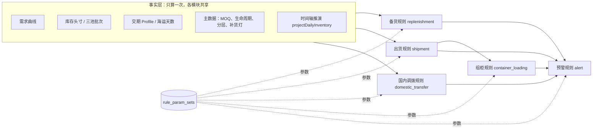

# 规则模块化（规则中心）设计

> 日期：2026-10-26 ｜ 状态：已评审（整体架构 + 第 0 期）  
> 相关：`docs/business/scm-demand-supply-inventory-logic.md`（现行口径）、`apps/web/server/tasks/replenishmentForecast.ts`、`apps/web/server/lib/alert-action.ts`

---

## 1. 背景与问题

供应链判断规则（备货、出货、预警、安全库存）目前以代码常量与函数散落在十余个文件中：

| 问题 | 例子 |
|------|------|
| 参数重复定义 | 默认安全库存 14 天：`replenishment-coverage.ts` `DEFAULT_SAFETY_STOCK_DAYS`、`safety-stock-z.ts` `DEFAULT_PLANNING_SAFETY_STOCK_DAYS`、`safety-stock-suggestion-service.ts` `DEFAULT_CONFIGURED_SAFETY_STOCK_DAYS`、`alert-action.ts` `DEFAULT_ALERT_SAFETY_DAYS` |
| 规则与流程耦合 | `runReplenishmentForecast` 约 760 行，取数、推演、判断、落库混在一个函数 |
| 业务不可调参 | 单次补货 30 天封顶、紧急发货余量 7 天、发货余量 15 天、驾驶舱 90/120/150/180/300 分档，改动需开发发版 |
| 无法追溯 | 建议 / 预警落库时不记录当时使用的参数，参数调整后无法解释历史结论 |

后续还要新增国内调拨、组柜、预警分级等规则，若沿用现状会继续放大以上问题。

## 2. 目标与非目标

**目标**

1. 每类规则成为独立模块：输入 / 参数 / 输出 / 判断依据清晰，纯函数可单测。
2. 参数入库，按作用范围分层覆盖，计划/PMC 负责人可编辑、管理员审批生效。
3. 每次评估可追溯到参数版本；生效前可试算对比。
4. 模块接口为后续「条件表达式」类规则引擎能力预留扩展点。

**非目标（本设计全程）**

- 不做通用低代码 / DSL 规则引擎（仅在 §7 演进路线中限定开放点）。
- 不替代事实层计算（需求曲线、头寸、三池批次、时间轴推演）。

## 3. 整体架构



原则：

- **事实层与规则层分离**：事实层负责「把数算对」，规则层负责「做判断」，规则模块不访问数据库。
- **预警是汇总者**：预警模块消费其他模块的结论做分级与派单，不再自行重算一套口径。
- **组柜在出货之后**：出货决定哪些货该发、发往哪个仓、紧急程度；组柜决定怎么装柜。

### 3.1 模块与职责边界

| 模块编码 | 回答的问题 | 主要输入 | 主要输出 | 阶段 |
|----------|------------|----------|----------|------|
| `replenishment` | 要不要下单、下多少、何时下 | 时间轴净/毛缺口、交期、安全库存、MOQ、补货灯 | 建议量、建议下单日、决策灯、门禁标志 | 第 0 期 |
| `shipment` | 要不要发、多急 | 确定可售天数、海运交期、可发批次 | 紧急发货 / 发货 / 来不及（调价） | 第 1 期 |
| `alert` | 风险落哪一档、几级、派给谁 | 各模块结论 + 覆盖天数 | 分档、L1–L3、责任人 | 第 2 期 |
| `domestic_transfer` | 国内仓之间要不要调、调多少 | 分仓头寸、需求占比、调拨成本/时效 | 调拨建议 | 第 3 期（需 PRD） |
| `container_loading` | 怎么拼柜、柜型、满载率 | 出货建议、箱规体积/重量、柜型 | 组柜方案 | 第 3 期（需 PRD 与箱规主数据） |

## 4. 规则模块契约

目录：`apps/web/server/rules/<module>/`，统一结构：

| 文件 | 内容 |
|------|------|
| `params.ts` | zod 参数 schema：每项含中文名、单位、默认值、取值范围、说明；规则中心表单据此渲染 |
| `evaluate.ts` 等 | 纯函数判断（如备货的 `decideReplenishmentQty`、`decideWarehouseCandidate`），输入事实与参数、输出结论与 trace，不访问数据库。各模块的事实类型不同，判断函数按模块各自导出，不强求统一签名 |
| `index.ts` | `defineRuleModule({ code, name, description, version, params, scopes })` 模块元数据，并 re-export 判断函数 |
| `*.test.ts` | 参数边界与判断分支单测 |

注册表：`apps/web/server/rules/registry.ts`，列出全部模块；规则中心页面与 API 按注册表自动生成。

```ts
export const replenishmentRule = defineRuleModule({
  code: 'replenishment',
  name: '备货规则',
  version: 1,
  params: z.object({
    singleCoverDays: param.int({ label: '单次补货覆盖天数', unit: '天', default: 30, min: 7, max: 180 }),
    // ...
  }),
  scopes: ['global', 'project_group', 'warehouse'],
  evaluate(facts, params) {
    // return { decision, qty, date, flags, trace }
  },
});
```

**`RuleResult.trace`**：判断依据数组，每项 `{ rule, param?, value?, note }`。例如「确定缺货日 2026-12-03 ≤ 今天+总交期 → 红灯」「净缺口 240，30 天需求封顶 240，MOQ 抬升至 320」。写入落库对象的 `metrics.ruleTrace`，前端用于展示「为什么」。

**策略变体**：同一问题允许多种算法时，以枚举参数选择（如备货 `strategy: 'timeline_net' | 'coverage_days'`），不另建模块。

## 5. 参数存储与生效

### 5.1 表结构

**`rule_param_sets`**

| 字段 | 类型 | 说明 |
|------|------|------|
| `id` | uuid | 主键 |
| `module_code` | varchar | 模块编码 |
| `scope_type` | varchar | `global` / `project_group` / `category` / `warehouse` / `sku` |
| `scope_value` | varchar | `global` 时为 `*` |
| `params` | jsonb | 仅存该层覆盖的键（稀疏），未出现的键向上继承 |
| `version` | int | 同 `(module_code, scope_type, scope_value)` 内递增 |
| `status` | varchar | `draft` / `pending_approval` / `active` / `archived` |
| `note` | text | 修改说明（新建必填） |
| `review_note` | text | 驳回原因 |
| `simulated_at` | timestamptz | 最近一次试算时间；为空不可提交 |
| `created_by` / `approved_by` | uuid | 用户 |
| `approved_at` / `activated_at` | timestamptz | |

约束：同 `(module_code, scope_type, scope_value)` 至多一条 `active`（部分唯一索引）。新版本审批通过时，旧 `active` 置 `archived`。

**`rule_eval_runs`**

| 字段 | 说明 |
|------|------|
| `id` | 主键 |
| `module_code` | 模块编码 |
| `trigger` | `task` / `simulation` / `page` |
| `param_set_ids` | 本次解析用到的全部 `active` 参数集 id 列表 |
| `module_version` | 代码侧模块版本号 |
| `started_at` / `finished_at` | |

`reorder_suggestions.metrics.ruleRunId` 记录对应 run；后续预警同理。

### 5.2 解析优先级

从低到高：全局 → 项目组 → 品类 → 仓库 → SKU，越具体越优先，按键合并。数据库无任何行时，使用 `params.ts` 中的代码默认值（与现行常量一致）。

第 0 期仅开放 `global`、`project_group`、`warehouse` 三层；`category`、`sku` 表结构支持但页面不开放。

任务运行时在开始阶段一次性加载全部 `active` 参数集并缓存，同一次运行内参数不变；运行中途审批生效的新版本从下一次运行起使用。

### 5.3 权限与审批

| 动作 | 角色 |
|------|------|
| 查看参数、查看试算结果 | 所有可访问规则中心的登录用户 |
| 新建 / 编辑草稿、发起试算、提交审批、从历史版本恢复 | `pmc_planner`、`super_admin` |
| 审批生效、驳回 | `super_admin` |

通过现有 `requireRole` 实现（`super_admin` 默认放行）。查看权限由菜单 `system.rules` 授予 `super_admin`、`pmc_planner`、`viewer`。

### 5.4 试算

`POST /rules/:module/param-sets/:id/simulate`：入参为 SKU 范围（项目组或 SKU 列表），第 0 期同步执行，**单次最多 50 个 SKU**（补货计算逐 SKU 逐仓查库，更大范围需改异步任务）。对同一份事实分别用「当前生效」与「草稿」参数以 dry-run 方式评估，返回有差异的行（建议量、日期、灯色）。试算不写建议表、不写健康快照；成功后记录草稿的 `simulated_at`，草稿再次编辑会清空它。

审批流转：`draft` →（试算后）提交 → `pending_approval` → 管理员审批 → `active`（同作用范围旧 `active` 归档）；驳回则回到 `draft` 并记录 `review_note`。回滚 = 从 `archived` 版本「恢复为草稿」，再走一遍试算与审批。

## 6. 第 0 期：框架 + 备货规则

### 6.1 拆分 `runReplenishmentForecast`

| 段 | 职责 | 落点 |
|----|------|------|
| 取数 | 批量加载销量、预测、头寸、批次、交期、MOQ、需求门禁数据 | `apps/web/server/facts/planning-facts.ts`，产出每 SKU × 仓的 `PlanningFacts` 与网络级 `NetworkPlanningFacts` |
| 推演 | 逐日时间轴 | 沿用 `projectDailyInventory`，归入事实层 |
| 判断 | 补不补、补多少、何时下单、人工确认、黄灯联动、US 仓网延后 | `apps/web/server/rules/replenishment/` |
| 落库 | 写建议、健康快照、回写安全库存、记录 run | 留在 `tasks/replenishmentForecast.ts` |

**需要外移的逻辑**：「单次补货 30 天封顶」与「MOQ 抬升」当前在时间轴内部计算 `suggestedQty`。第 0 期把这段计算移到 `rules/replenishment/qty.ts`（`decideReplenishmentQty`），时间轴委托调用并接收 `coverDays` 入参；时间轴结果仍保留 `suggestedQty` 字段，因为有十余处调用方在读，彻底改为「只输出缺口」放到第 2 期预警迁移时一并处理。SKU 规划页（`inventory-planning-service.ts`）与补货任务读同一套解析后的参数，保证同源。

### 6.2 备货规则参数（第一批）

默认值均与现行代码一致。

| 参数键 | 中文名 | 默认 | 现行位置 |
|--------|--------|------|----------|
| `singleCoverDays` | 单次补货覆盖天数 | 30 | `inventory-timeline.ts` `SINGLE_REPLENISHMENT_COVER_DAYS` |
| `defaultSafetyStockDays` | 默认安全库存天数 | 14 | 4 处重复常量，合并为此参数 |
| `overstockThresholdDays` | 超储阈值 | 180 | `replenishment-coverage.ts` |
| `slowMovingDailyMax` | 滞销日均上限 | 0.1 | `inventory-light.ts` |
| `slowMovingMinCoverageDays` | 滞销覆盖下限 | 90 | `inventory-light.ts` `SLOW_MOVING_MIN_COVERAGE_DAYS` |
| `moqPriority` | MOQ 取值顺序 | `sku_then_spu` | `replenishment.ts` `resolveEffectiveMoq` |
| `yellowLightLinkage` | 黄灯联动（关 = 黄灯与红灯一样需要即补） | `true` | `replenish-light.ts` |
| `usNetworkDeferEnabled` | US 仓网延后 | `true` | `warehouse-domain.ts` |

说明：

- 被其他模块共用的参数（如默认安全库存天数）第 0 期挂在备货模块下；第 1 期起出货、预警模块通过「引用备货参数」读取，不再各自定义。
- **移出第 0 期的参数**：默认生产交期（50）、默认入仓缓冲（7）是交期事实的兜底值，属于事实层配置；远期预测缓冲（A 类 ×1.1 / B 类 P90）与需求反推封顶倍数（1.5）属于需求域，同时影响需求计划生成，只在备货侧改会造成口径分裂。这几项后续单独设计。
- 驾驶舱、预警、需求计划服务中对这些参数的引用，第 0 期仍用代码默认值，第 2 期迁移时统一读取解析后的参数。规则中心页面需提示这一点。

### 6.3 规则中心页面

- 菜单「系统设置」下新增「规则中心」（菜单 code `system.rules`），路由 `/system/rules`，与现有系统页一致；每个已注册模块一个标签页。
- 标签页内容：参数表（全局值 + 覆盖了哪些项目组 / 仓）、版本历史、待审批列表、试算入口。
- 参数表单由模块 `params.ts` 的 schema 生成，展示中文名、单位、默认值、取值范围、说明。
- UI 遵循 `scm-design` Skill 规范。

### 6.4 API

| Method | Path | 用途 |
|--------|------|------|
| GET | `/rules` | 已注册模块列表与参数 schema |
| GET | `/rules/:module/param-sets` | 参数集列表（按作用范围、状态筛选） |
| GET | `/rules/:module/resolved` | 查询某作用范围组合下的最终生效参数及每个键的来源层 |
| POST | `/rules/:module/param-sets` | 新建草稿 |
| PATCH | `/rules/:module/param-sets/:id` | 编辑草稿 |
| POST | `/rules/:module/param-sets/:id/simulate` | 试算 |
| POST | `/rules/:module/param-sets/:id/submit` | 提交审批 |
| POST | `/rules/:module/param-sets/:id/approve` / `reject` | 管理员审批 / 驳回 |
| POST | `/rules/:module/param-sets/:id/restore` | 从历史版本恢复为草稿 |

### 6.5 迁移不改结果的保证

1. **基线**：迁移前用现行代码对一份生产数据快照运行补货任务，导出每个 SKU × 仓（及网络行）的建议量、建议日期、决策灯、`needsManualConfirm` 作为基线文件。
2. **对照**：迁移后在同一快照、数据库无参数集（即全部取代码默认值）的条件下运行，结果须与基线**逐行一致**。
3. **单测**：`inventory-timeline.test.ts`、`replenishment-coverage.test.ts`、`network-replenishment.test.ts`、`replenish-light` 相关测试全部通过；新增备货规则单测覆盖每个参数的边界。
4. 第 0 期只做搬迁与参数化，不改变任何业务判断。

### 6.6 第 0 期不做

- 出货、预警、安全库存模块的迁移。
- 条件表达式 / 低代码。
- `category`、`sku` 两层覆盖的页面入口。

## 7. 后续分期路线

| 阶段 | 内容 | 前置 |
|------|------|------|
| 第 1 期 | 出货规则模块：`alert-action.ts` 中紧急发货余量（7）、发货余量（15）、海运交期解析顺序；清理剩余重复常量 | 第 0 期框架 |
| 第 2 期 | 预警规则模块：驾驶舱分档（90/120/150/180/300、近断货保护 120）、Horizon 7/15/30、L1–L3 分级与责任人；改为消费备货与出货结论 | 第 1 期 |
| 第 3 期 | 国内调拨、组柜两个新模块 | 各自 PRD；组柜需箱规体积 / 重量、柜型主数据 |
| 后续 | 在限定位置开放条件表达式（如预警过滤条件、组柜优先级排序），以 JSON 条件树存于参数集，配合试算使用 | 模块契约稳定 |

## 8. 风险

| 风险 | 应对 |
|------|------|
| 时间轴内部建议量外移导致规划页与任务口径偏离 | 规划页与任务都调用备货规则；基线对照覆盖网络行与分仓行 |
| 参数错配导致大面积建议变化 | 草稿必须试算后才能提交；审批人可见试算差异；支持一键回滚到上一 `active` 版本 |
| 每 SKU 解析参数带来性能开销 | 任务开始时一次性加载并按作用范围建索引，评估期间纯内存查找 |
| 代码模块版本升级后旧参数键失效 | 模块 `version` 变化时，参数解析对未知键忽略并在规则中心标记「已废弃键」 |
