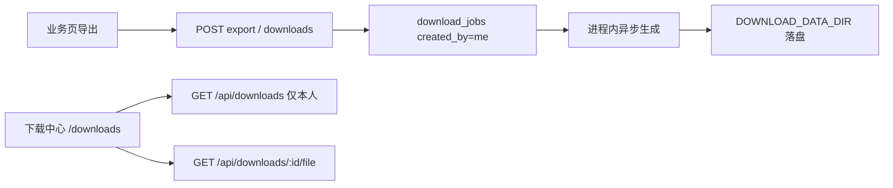

# 下载中心（异步导出）设计

## 背景

业务导出多为同步 GET（内存拼 CSV/XLSX/ZIP 后直出），大数据量易因网关超时（502/504/524）失败。下载中心本身不治本；需异步生成、落盘，再短请求下载。

## 方案

独立表 `download_jobs` + 页面 `/downloads`。用户只能查看/操作自己的任务（`created_by`）。

## 数据模型

### 表：download_jobs

| 字段 | 类型 | 说明 |
|------|------|------|
| id | uuid | 主键 |
| created_by | uuid | 必填，FK → users |
| job_type | varchar | 导出类型，如 sales_forecast_horizon |
| title | varchar | 列表展示名 |
| file_name | varchar | 下载文件名 |
| params_json | text | 导出参数快照 |
| status | enum | pending / running / ready / failed / cancelled / expired |
| storage_path | varchar | 相对 DOWNLOAD_DATA_DIR |
| file_size | integer | 字节 |
| content_type | varchar | MIME |
| row_count | integer | 可选行数 |
| error_message | text | 失败原因 |
| expires_at | timestamptz | 默认创建 +15 天；逾期清理任务物理删除 |
| created_at / finished_at | timestamptz | |

索引：`(created_by, created_at)`、`(status, expires_at)`。

## 页面流程

1. 业务页点导出 → 创建本人任务 → toast「已加入下载中心」
2. `/downloads` 列表仅本人；筛选状态；ready 下载；failed 重试；pending/running 取消；删除清理文件
3. 一期不做飞书通知、不做共享、管理员不看全量

## API

均校验 `created_by = 当前用户`；越权统一 404。

- `GET /api/downloads`、`GET /api/downloads/:id`
- `GET /api/downloads/:id/file`（仅 ready）
- `POST /api/downloads/:id/retry`、`POST /api/downloads/:id/cancel`
- `DELETE /api/downloads/:id`
- 业务大导出改为 202 `{ jobId }`

## 执行与存储

- `DOWNLOAD_DATA_DIR`（Compose volume），临时文件 rename
- 进程内异步：全局并发 2，单用户进行中上限 5
- 过期清理 cron（超过 15 天有效期删文件并清空记录）；stale running 自动失败

## 一期接入

预测/需求矩阵导出、库存类导出。小文件同步导出可暂留。
